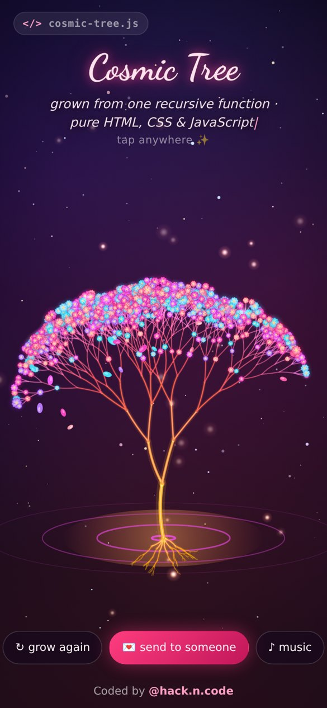
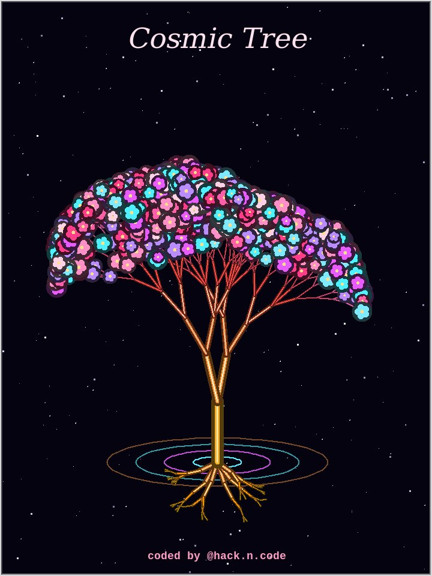

<h1 align="center">🌌 Cosmic Tree</h1>
<p align="center"><b>A neon tree that grows from glowing roots, branches out under the stars and bursts into glowing blossoms.</b><br>
Pure HTML, CSS & JavaScript (no libraries) + a bonus Python turtle version.</p>

<p align="center">
  <a href="https://cosmic-tree-hackncode.sites.tab.bot/"><b>▶ Live demo</b></a> ·
  <a href="https://www.instagram.com/hack.n.code/">Instagram @hack.n.code</a> ·
  <a href="https://github.com/hackncode1020/cosmic-tree-24-10-26/archive/refs/heads/main.zip">⬇ Download ZIP</a>
</p>

<p align="center"></p>

## ✨ Features
- 🌱 The tree **grows live** from its roots: recursive branches drawn segment by segment with neon glow
- 🌸 Hundreds of **glowing 5-petal blossoms** pop open, then petals drift down
- 🌊 Neon **ripple rings**, twinkling **starfield**, shooting stars and fireflies
- 👆 **Tap anywhere** for a burst of petals and sparkles · **↻ grow again** for a brand-new random tree
- 💌 **Send to someone**: share a link like `?to=Riya` and the page says *"for Riya"*
- 🎵 Optional ambient music, synthesized live with the Web Audio API (no audio files)
- 📱 Smooth on phones: finished branches are baked into an offscreen layer, so only the growing parts redraw each frame

## 🚀 How to run (web)
1. Click **Code → Download ZIP** (or the Download ZIP link above) and unzip it
2. Double-click **`index.html`**, it opens in your browser. That's it, no install, no build step.

> Tip: for the custom font to load in every browser, you can also run a tiny local server in the folder: `python -m http.server` and open http://localhost:8000

## 🐍 How to run (Python turtle version)
```bash
cd python
python cosmic_tree.py
```
Uses only the Python standard library (`turtle`). Click the window to grow a new tree.

<p align="center"></p>

## 🗂 Files
| File | What it does |
|---|---|
| `index.html` | Page structure, message, buttons, share sheet |
| `style.css` | Neon/glass UI, responsive layout |
| `script.js` | The whole animation: tree generation, blossoms, petals, stars, ripples, music |
| `fonts/` | Dancing Script (SIL Open Font License) |
| `python/cosmic_tree.py` | Python turtle version |

## 🛠 Make it yours
- Blossom colors: `BLOOM_PAL` in `script.js`
- Tree size / branching: `maxDepth`, `spread` and the `branch()` function
- Message text: `MESSAGE` near the top of `script.js`

## 💜 Credits
Coded by **[@hack.n.code](https://www.instagram.com/hack.n.code/)**. If you use it, tag me on Instagram!
Follow for more coding animations. **DM for codes.**

MIT License
